<div align="center">

# Immersive-Craft

<p>Interactive 3D Studies</p>

**Take objects apart. Build spaces from the ground up. Discover how things fit together.**

[Open the ChatGPT Site](https://immersive.teerananpakdeekhan.chatgpt.site/) · [Explore the worlds](#the-worlds) · [Run locally](#getting-started) · [Tech stack](#tech-stack)

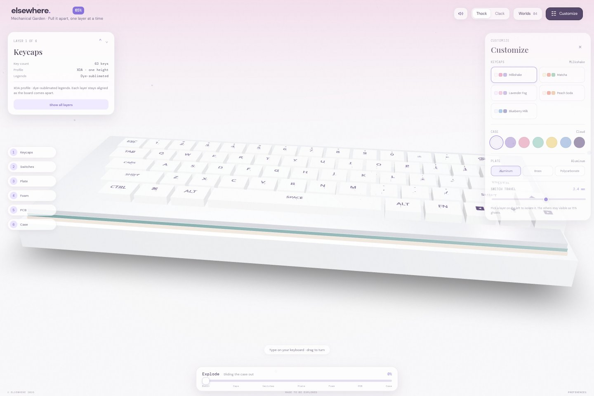

*Mechanical Garden, captured from the running application. All application images below are real browser screenshots.*

</div>

Immersive-Craft is a browser-based collection of interactive object and architecture studies. Its two implemented worlds turn mechanical and structural details into things you can inspect, move, customize, and assemble: a compact mechanical keyboard and a Japanese-inspired timber pavilion.

The current application and wireframe archive retain their original **Elsewhere** branding. This README uses the new project name, **Immersive-Craft**; the repository slug and published URLs remain unchanged.

> **Status:** experimental prototype. Two interactive worlds are implemented; two catalog entries are planned. Home, Explore, and related archive pages are separate HTML wireframes. This is a frontend application with no backend, accounts, or cloud-saved progress.

<p><strong>Contents</strong></p>

- [The worlds](#the-worlds)
- [Mechanical Garden](#mechanical-garden)
- [Kigumi Pavilion](#kigumi-pavilion)
- [Design archive](#design-archive)
- [Tech stack](#tech-stack)
- [Architecture and project structure](#architecture-and-project-structure)
- [Getting started](#getting-started)
- [Build and hosting](#build-and-hosting)
- [Browser support and troubleshooting](#browser-support-and-troubleshooting)
- [Development roadmap](#development-roadmap)
- [Contributing, credits, and license](#contributing-credits-and-license)

## The worlds


*The application catalog separates available experiences from upcoming concepts.*

| World | Focus | Implementation | Local route |
| --- | --- | --- | --- |
| **01 · Mechanical Garden** | Keyboard anatomy and materials | Interactive 3D prototype; default entry | `/` or `/?world=mechanical-garden` |
| **02 · Kigumi Pavilion** | Timber assembly and atmosphere | Interactive 3D prototype with illustrated graphics fallback | `/?world=kigumi` or `/world/kigumi` |
| **03 · Aurora Drift** | Sky | Planned catalog entry; no scene module | None |
| **04 · Mosslight Grove** | Nature | Planned catalog entry; no scene module | None |

**Published experience:** [immersive.teerananpakdeekhan.chatgpt.site](https://immersive.teerananpakdeekhan.chatgpt.site/). Feature screenshots document this repository running locally; the published Site can change independently. Local routes describe the router implemented in [src/main.jsx](src/main.jsx).

## Mechanical Garden

A tactile study of a **65%-style mechanical keyboard**. Pull its layers apart and inspect the components while keeping their spatial relationship visible.

### Exploded view and layer isolation

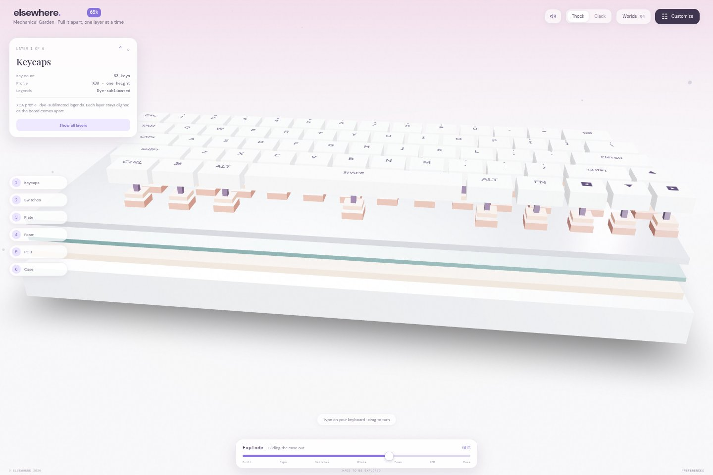

*A continuous exploded view reveals how the keyboard is constructed.*

| Interaction | How to use it | What happens |
| --- | --- | --- |
| Explode the assembly | Drag **Explode** from 0 to 100 | Layers separate continuously rather than jumping between fixed views. |
| Inspect a layer | Choose **Keycaps, Switches, Plate, Foam, PCB, or Case** in the rail; scene parts are also clickable | The selected layer stays prominent; other layers become 15% ghosts. |
| Isolate keycaps | Double-click a keycap | The keycap layer becomes the active selection. |
| Restore the assembly | Select **Show all layers** and return Explode to 0 | All components return to the assembled overview. |
| Orbit the scene | Drag across the 3D view | The camera rotates around the keyboard. |

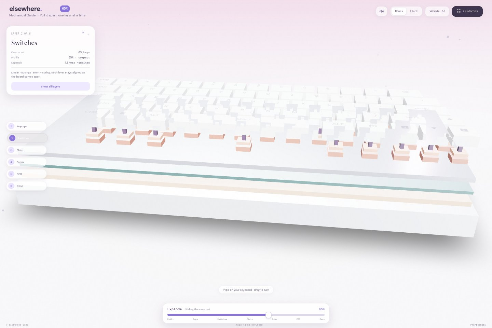

*Layer isolation preserves context instead of hiding the rest of the object completely.*

### Materials and customization

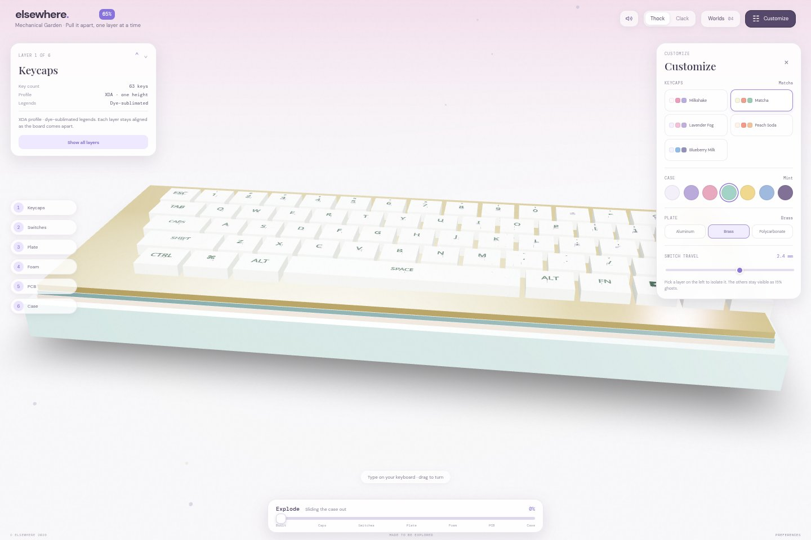

*The customization drawer changes the rendered board immediately.*

- **Five keycap palettes:** Milkshake, Matcha, Lavender Fog, Peach Soda, and Blueberry Milk.
- **Seven case finishes:** Cloud, Lilac, Blush, Mint, Butter, Periwinkle, and Plum.
- **Three plate materials:** Aluminum, Brass, and Polycarbonate, with distinct colors and material properties.
- **Switch travel:** adjustable through the drawer's travel slider.
- **Keyboard sound:** mute/unmute and choose the synthesized **Thock** or **Clack** character.

These choices live in the world's Zustand store for the current page session. They are not saved to an account or restored after a reload.

### Keyboard input and switch anatomy

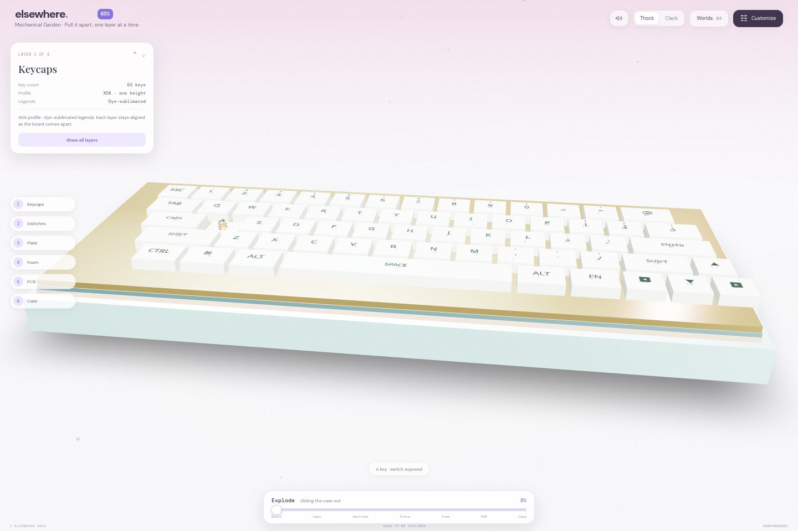

*Typing and hovering reveal details that are easy to miss in the assembled view.*

Hover over a key to expose its switch components. Physical keyboard input presses the matching virtual key and triggers optional synthesized audio.

Printable characters follow the browser's active keyboard layout and match the board's English legends. Modifiers, arrows, and other special keys use physical key codes. Thai/IME characters and symbols without a matching legend do not activate a key. Inputs inside text fields are ignored, and common browser shortcuts remain available.

## Kigumi Pavilion

A Japanese-inspired pavilion grows from a quiet garden floor into a complete timber structure. Staged assembly shows what each part supports before moving on.

### Seven-stage assembly

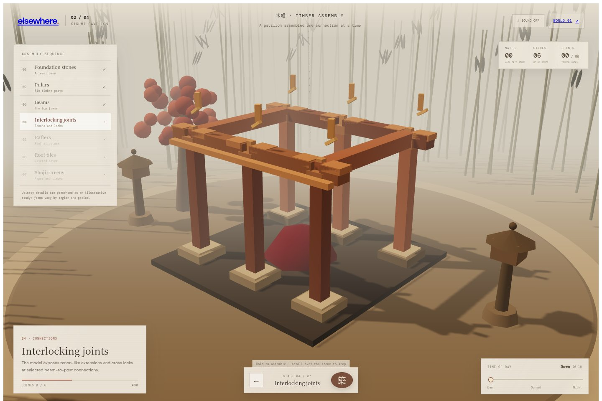

*The exposed frame makes the relationship between posts and beams visible.*

| Stage | Component | What the study reveals |
| --- | --- | --- |
| 01 | Foundation stones | The footprint and raised support points. |
| 02 | Pillars | Six timber posts carrying the structure above. |
| 03 | Beams | The longitudinal and crosswise top frame. |
| 04 | Interlocking joints | Six illustrated tenon-like connections with separate cross locks. |
| 05 | Rafters | The members defining the roof's span and slope. |
| 06 | Roof tiles | Overlapping cover across the roof planes. |
| 07 | Shoji screens | Timber-and-paper-inspired enclosure around the central opening. |

Hold **Build** for approximately 0.85 seconds to advance. You can also hold **Space** or **Enter** while the control is focused. Scroll over the scene or swipe vertically to step through assembly; previously unlocked stages remain accessible from the rail. Complete all six connection sequences before continuing to the roof.

### Connection studies

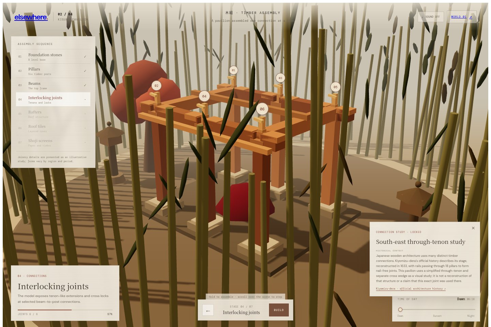

*Completed connections can be replayed individually from their numbered markers.*

Each connection has a focused animation that exposes, rotates, slides, and locks its components. Select a completed numbered connection to replay it and read the context note.

The geometry is an **illustrative through-tenon and cross-wedge study**. It is not a reconstruction of a historic pavilion or evidence that a particular named joint was used in a specific building. The contextual reference is [Kiyomizu-dera's official architecture history](https://www.kiyomizudera.or.jp/en/learn/).

### Light, atmosphere, and sound

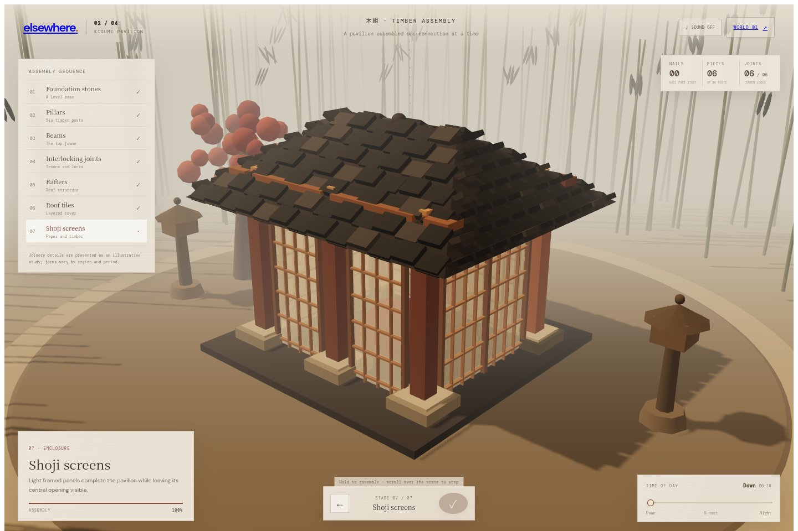

*The completed pavilion at the first time-of-day setting.*

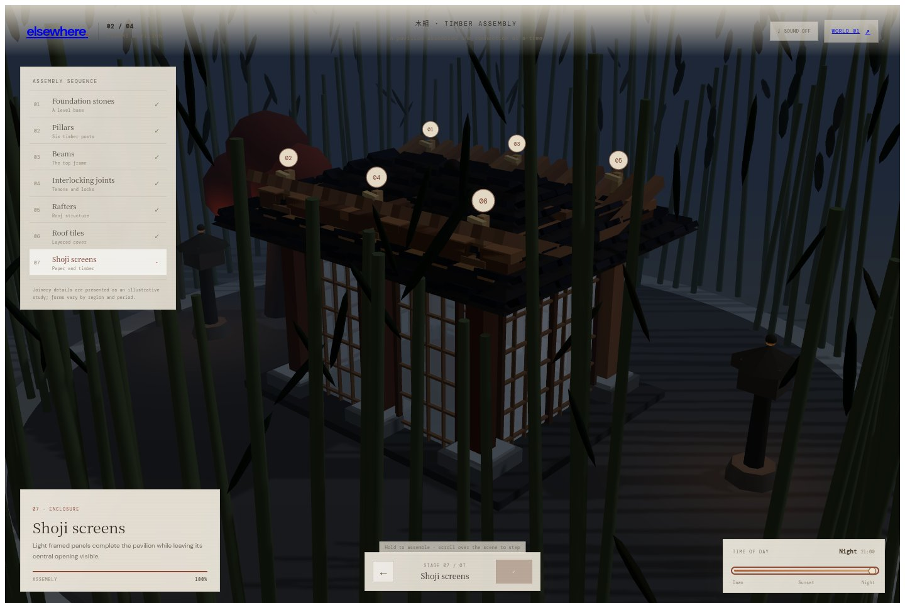

*The time slider changes the lighting, shadows, sky, and lantern atmosphere.*

Move **Time of day** from dawn through sunset to night. Optional garden wind starts muted and uses a locally bundled, generated OGG loop through Howler.js. Geometry and materials are procedural; the pavilion does not ship with source texture packs or KTX2 textures.

For rendering efficiency, bamboo foliage, falling leaves, and **220 roof tiles** use instanced meshes. Contact shadows use a bounded, low-resolution render after assembly changes. The interface also includes a compact layout for short landscape viewports.

## Design archive

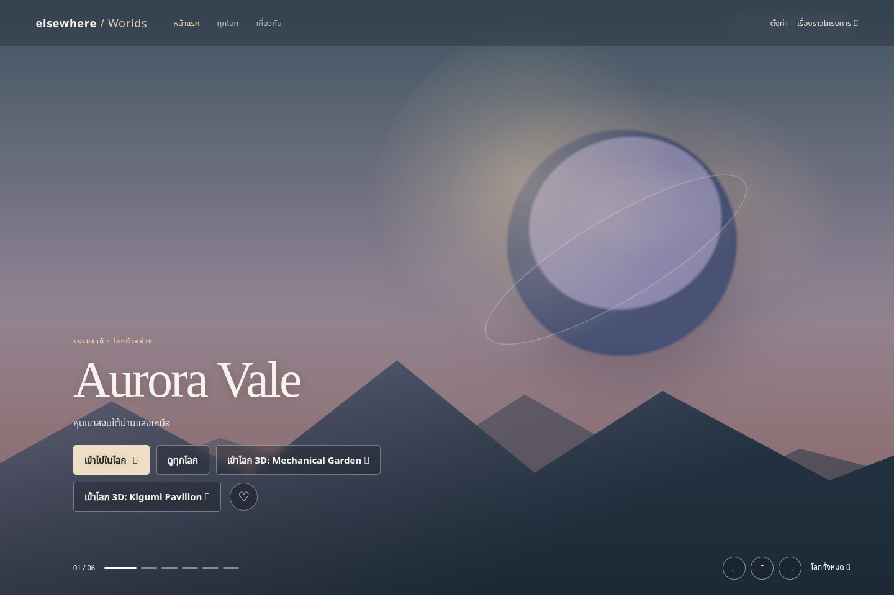

*The earlier homepage concept is an interactive HTML/CSS wireframe, not a rendered 3D world.*

The [wireframes directory](wireframes/) preserves the broader product concept: browsing, discovering, and favoriting immersive worlds. Its sample catalog differs from the implemented React catalog and should not be read as a list of finished scenes.

| Page | Local URL | Available behavior |
| --- | --- | --- |
| Home | `/wireframes/index.html` | Scenery carousel, manual navigation, pause controls, and reduced-motion support. |
| Explore | `/wireframes/explore.html` | Search, category filters, favorites filtering, and sorting. |
| World detail | `/wireframes/world-detail.html?id=aurora` | Sample world descriptions, artwork, and favorites. |
| Settings | `/wireframes/settings.html` | Example preferences stored in the browser. |
| About & updates | `/wireframes/about-updates.html` | Product concept and example update content. |

Favorites use `localStorage` under `elsewhere.favorites.v2` and are shared between archive pages on the same origin. Example settings use `elsewhere.prefs.v2`; they do not configure the React worlds. Run Vite when following archive links into the 3D application. See the [archive README](wireframes/README.md) for its original Thai documentation and other sample world IDs.

## Tech stack

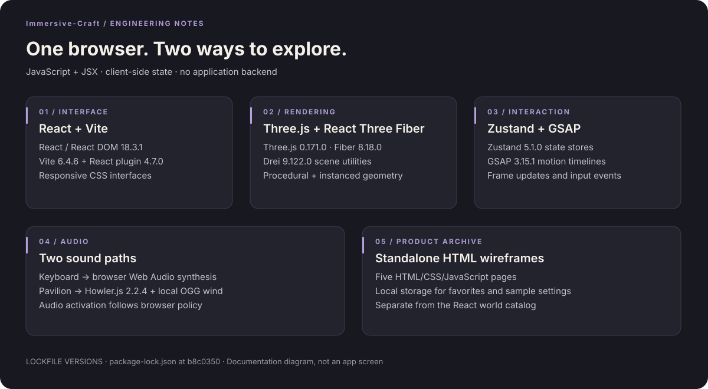

*A source-based stack map. Versions below are resolved from the committed package-lock.json, rather than dependency ranges.*

| Layer | Technology | Locked version | Responsibility |
| --- | --- | --- | --- |
| UI | React / React DOM | 18.3.1 / 18.3.1 | World interfaces, controls, lazy loading, and rendering. |
| Build tooling | Vite / React plugin | 6.4.6 / 4.7.0 | Development server, JSX transform, and production bundles. |
| 3D engine | Three.js | 0.171.0 | Geometry, materials, lighting, cameras, and WebGL rendering. |
| React renderer | React Three Fiber | 8.18.0 | React scene graph, canvas lifecycle, and frame updates. |
| Scene utilities | Drei | 9.122.0 | Orbit controls, contact shadows, text, and scene helpers. |
| State | Zustand | 5.1.0 | Keyboard configuration/input state and assembly progression. |
| Motion | GSAP | 3.15.1 | Interface entrances, assembly transitions, and joint sequences. |
| Ambient audio | Howler.js | 2.2.4 | Pavilion wind playback, looping, fades, and muting. |
| Key audio | Browser Web Audio API | Browser-provided | Synthesized keyboard sounds; no recorded key-sound files. |
| Styling & archive | CSS / HTML / JavaScript | Browser-provided | Responsive controls and standalone interactive wireframes. |

**Language:** JavaScript with JSX. **Data:** static metadata and client-side state. **Infrastructure:** no application server, database, authentication service, or API keys are required.

## Architecture and project structure

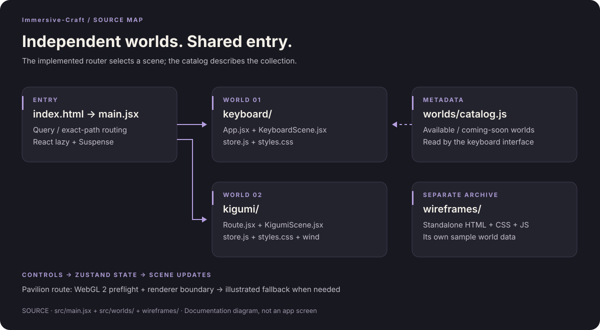

*World metadata is independent of scene modules. The wireframe archive is a separate implementation.*

```text
.
├── index.html                    # Vite HTML entry
├── package.json                  # Dependencies and npm scripts
├── package-lock.json             # Reproducible dependency resolution
├── vite.config.js                # Vite + React configuration
├── src/
│   ├── main.jsx                  # Query/path router and lazy imports
│   └── worlds/
│       ├── catalog.js            # Available and planned world metadata
│       ├── keyboard/
│       │   ├── App.jsx           # Interface, customization, input handling
│       │   ├── KeyboardScene.jsx # Keyboard geometry and interaction
│       │   ├── store.js          # State and material presets
│       │   └── styles.css
│       └── kigumi/
│           ├── Route.jsx         # Assembly interface, audio, fallback
│           ├── KigumiScene.jsx   # Pavilion, garden, connection animation
│           ├── store.js          # Stages, progression, context notes
│           ├── styles.css
│           └── assets/
│               └── wind-loop.ogg
├── wireframes/                   # Five archive pages + README
├── docs/images/                  # Screenshots and documentation diagrams
└── LICENSE                       # MIT license
```

1. `main.jsx` chooses the pavilion for `?world=kigumi` or the exact path `/world/kigumi`; other values resolve to the keyboard.
2. React `lazy` and `Suspense` load the selected module with a loading state.
3. Each world owns its interface, scene, styles, and Zustand store. Controls update state, and scene components reflect those changes.
4. Repeated keyboard components, garden foliage, and pavilion roof tiles use instanced meshes. GSAP coordinates timed transitions.
5. The pavilion checks WebGL 2 support and handles renderer errors/context loss with an illustrated fallback.

To add a world, create its scene/interface/store, register a lazy import and routing condition in `main.jsx`, and add metadata to `catalog.js`. A catalog entry alone does not create a working route.

## Getting started


*The default development route opens Mechanical Garden.*

**Requirements:** a recent Node.js LTS release with npm, Git, and a modern WebGL 2-capable browser. Installation and build were verified with **Node.js 24.22.1 and npm 11.9.0**. No `.env` file or service credentials are needed.

```bash
git clone https://github.com/01aptx01/3d-immersive-website.git
cd 3d-immersive-website
npm ci
npm run dev
```

Open the URL printed by Vite, normally `http://localhost:5173`. Vite may choose another port if that port is occupied.

| Command | Purpose |
| --- | --- |
| `npm ci` | Install the exact dependency tree from the lockfile. |
| `npm run dev` | Start Vite with live reload. |
| `npm run build` | Generate the production application in `dist/`. |
| `npm run preview` | Preview production output locally; this is not a production hosting server. |

For a quick tour, open `/`, move Explode, select a layer, and change a palette. Then open `/?world=kigumi`, hold Build through the stages and six joints, and move the time slider to Night.

## Build and hosting

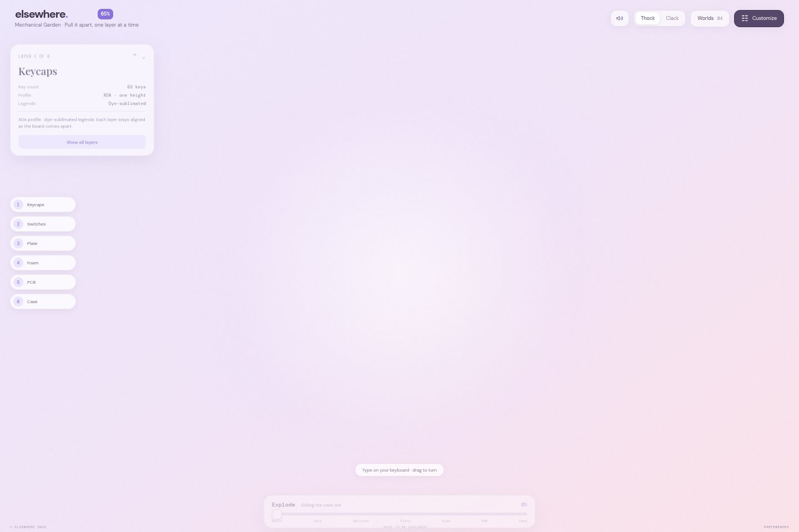

*The public Site supplied for this project: [open the published experience](https://immersive.teerananpakdeekhan.chatgpt.site/).*

```bash
npm ci
npm run build
npm run preview
```

Deploy the contents of **`dist/`** to a static host. The build uses Vite's default root base path. If hosting under a subdirectory, review both Vite's `base` setting and the application's root-relative links.

**Include the wireframe archive explicitly.** It lives outside Vite's `public/` directory and is not included in `dist/` by `npm run build`. Run this after each build and before previewing/uploading:

```bash
node -e "require('node:fs').cpSync('wireframes', 'dist/wireframes', { recursive: true })"
```

Configure the host so `/world/kigumi` serves the application entry (`index.html`), while existing static files are served normally. Query routes such as `/?world=kigumi` use the root entry directly and are the simplest option when SPA rewrites are unavailable.

This repository does not include an automated ChatGPT Site publishing pipeline. Updating GitHub does not by itself update the linked Site.

## Browser support and troubleshooting

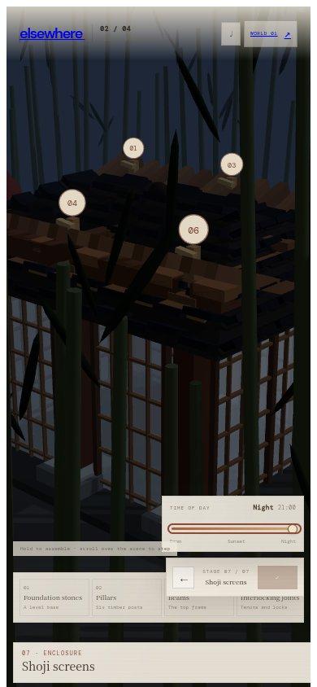

*The pavilion at 390 × 844. This demonstrates layout behavior, not a device-performance benchmark.*

The 3D scenes require **WebGL 2**. Try a current Chrome, Edge, Firefox, or Safari with graphics acceleration enabled. The pavilion adapts to smaller screens and respects reduced-motion preferences in its animated sequences; this is not a claim of a complete accessibility audit.

| Symptom | Explanation and next step |
| --- | --- |
| Pavilion displays an illustration | WebGL 2 is unavailable, the renderer failed, or its context was lost. Navigation remains; Build and time controls are disabled. Try a supported browser/device and reload. |
| Keyboard scene is blank | Check graphics support and the console. Its Drei environment preset and text utilities can fetch runtime assets; allow those requests. The keyboard has no illustrated fallback. |
| Typography looks different | Styles load Google Fonts. Blocked requests can cause fallback fonts. |
| No sound | Interact with the page to satisfy browser audio policy. Check the sound toggle and system volume. Pavilion wind starts muted. |
| A typed character does not activate a key | The board maps matching English legends. Thai/IME input and unmatched symbols are intentionally ignored. |
| Progress or colors reset on reload | World state is in memory. Archive favorites/settings use local storage separately. |
| Archive returns 404 after deployment | Copy `wireframes/` into `dist/wireframes/` after building. |
| Direct `/world/kigumi` visit returns 404 | Configure SPA fallback, or use `/?world=kigumi`. |
| Build warns about large chunks | The build succeeds, but shared 3D dependencies exceed Vite's default chunk warning threshold. Bundle optimization remains future work. |

The pavilion's procedural geometry and bundled wind do not depend on downloaded texture packs. The application as a whole is **not guaranteed to work fully offline**, because fonts and some keyboard scene helpers use external resources.

## Development roadmap

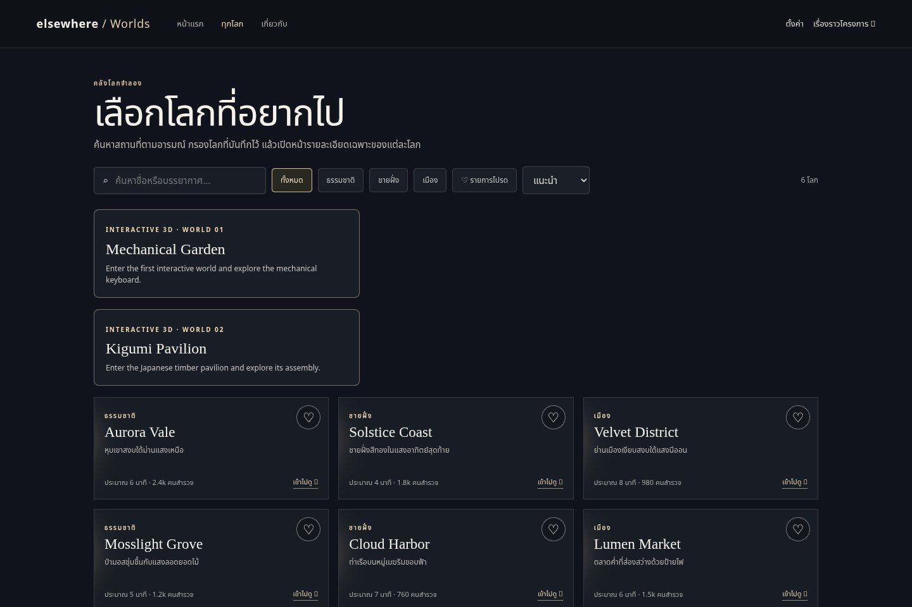

*The archive sketches a larger discovery experience; its sample worlds and visitor figures are prototype content.*

| Area | Current position | Possible next step |
| --- | --- | --- |
| Experiences | Keyboard and pavilion implemented | Refine interaction and performance on real devices. |
| New worlds | Aurora Drift and Mosslight Grove are placeholders | Implement independent scene modules. |
| Discovery | World selector plus separate archive pages | Build production navigation with one shared catalog. |
| Branding | Immersive-Craft is the project name; existing application screens retain Elsewhere branding | Rebrand application UI and metadata in a separate product change. |
| Reliability | Pavilion fallback; keyboard requires working graphics | Extend graceful failure handling and browser coverage. |
| Delivery | Build available; archive copy is manual | Automate archive packaging and investigate bundle size. |
| Quality | No test or lint scripts are defined | Add focused interaction checks as the project matures. |

These are development directions, not shipped capabilities or dated delivery commitments.

## Contributing, credits, and license

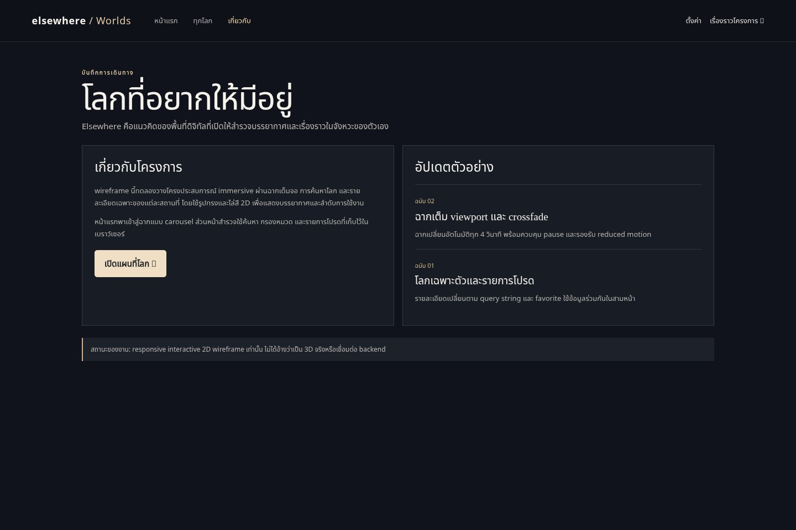

*The archive preserves the project's earlier design context alongside the implemented worlds.*

Open an [issue](https://github.com/01aptx01/3d-immersive-website/issues) before substantial changes. Keep pull requests focused and use Conventional Commits, for example `feat: add a world` or `docs: clarify assembly controls`.

Before submitting:

- Run `npm ci` and `npm run build`.
- Check both world routes and any affected archive pages.
- For visual changes, include real screenshots or a recording with viewport and interaction steps.
- For controls or animation, check keyboard behavior, reduced motion, and relevant graphics fallback behavior.
- Update catalog status and documentation to distinguish implemented features from concepts.

**Author:** [Teeranan Pakdeekhan / 01aptx01](https://github.com/01aptx01). Built with the open-source technologies above. Historical context links to [Kiyomizu-dera](https://www.kiyomizudera.or.jp/en/learn/); that reference does not imply endorsement or historical reconstruction accuracy.

**Images:** application captures are committed locally in [docs/images/](docs/images/), with descriptive alt text and source notes in the [image manifest](docs/images/README.md). Stack and architecture figures are source-based documentation diagrams. No placeholder screenshot URLs or generated product mockups are used.

**License:** [MIT](LICENSE), copyright © 2026 Teeranan Pakdeekhan. Preserve the license and copyright notice when redistributing the software.
